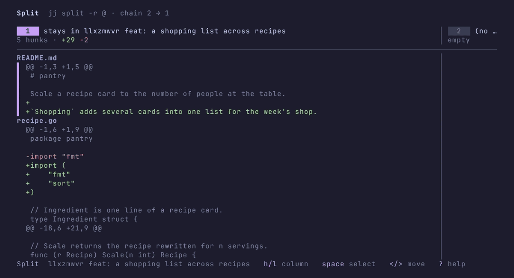
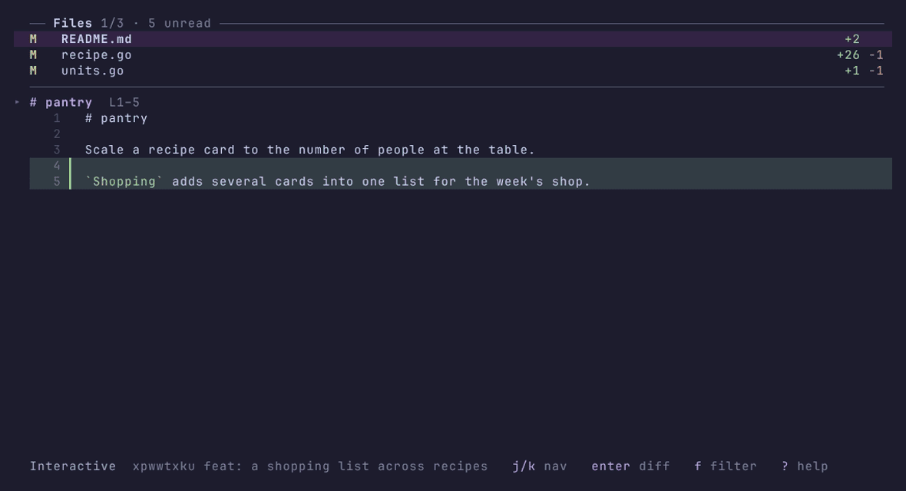
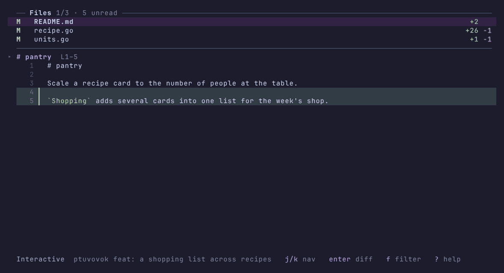
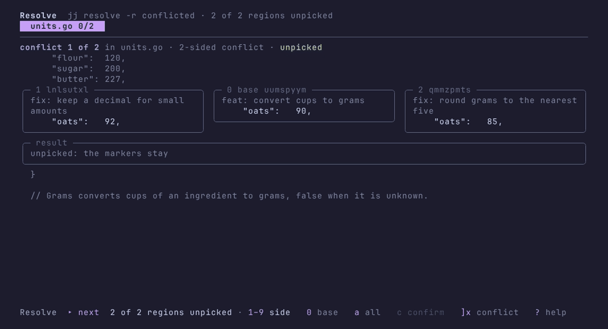

# jj-diff



Read a Jujutsu diff in the terminal and move parts of it around: pick hunks or
individual lines and send them to another revision, or split one commit into
several focused ones. Drops in as jj's diff editor for `jj split`, `jj diffedit`,
`jj amend -i`, and `jj squash -i`, so it works the same whether you run it from a
plain `jj` command line or from a TUI that shells out to one
([jj-tui](https://github.com/KyleKing/jj-tui), [jjui](https://github.com/idursun/jjui),
[lazyjj](https://github.com/Cretezy/lazyjj)).

## Alternatives

jj-diff is narrow on purpose: hunk and line moves between revisions, and splitting.
For adjacent problems, one of these may fit better:

| Tool | Notes |
| --- | --- |
| [crecord](https://www.mercurial-scm.org/wiki/CrecordExtension) | "allows you to interactively choose among the changes you have made, and commit only those changes you select" (Mercurial) |
| [Delta](https://github.com/dandavison/delta) | "A syntax-highlighting pager for git, diff, grep, rg --json, and blame output" |
| [Difftastic](https://github.com/Wilfred/difftastic) | "a structural diff that understands syntax" |
| [git add -p](https://git-scm.com/docs/git-add) | "interactively choose hunks of patch between the index and the work tree and add them to the index" (built into Git) |
| [gitui](https://github.com/gitui-org/gitui) | "Blazing fast terminal-ui for git written in rust" |
| [jj's built-in diff editor (scm-record)](https://github.com/arxanas/scm-record) | "a UI component to interactively select changes to include in a commit. It's meant to be embedded in source control tooling" |
| [jjui](https://github.com/idursun/jjui) | "A TUI designed for interacting with the Jujutsu version control system" |
| [KDiff3](https://github.com/KDE/kdiff3) | "Utility for comparing and merging files and directories" |
| [lazygit](https://github.com/jesseduffield/lazygit) | "simple terminal UI for git commands" |
| [lazyjj](https://github.com/Cretezy/lazyjj) | "TUI for Jujutsu/jj. Built in Rust with Ratatui. Interacts with jj CLI" |
| [Magit](https://github.com/magit/magit) | "A Git Porcelain inside Emacs" |
| [Meld](https://gitlab.gnome.org/GNOME/meld) | "Meld is a visual diff and merge tool targeted at developers" |
| [tig](https://github.com/jonas/tig) | "Text-mode interface for git" |
| [vimdiff](https://git-scm.com/docs/git-difftool) | Runs any diff as a Vim or Neovim split through `git difftool`, built into Git |
| _[awesome-jj](https://github.com/Necior/awesome-jj)_ | "A curated list of awesome Jujutsu things" |

## Install

```bash
# Homebrew
brew install --cask kyleking/tap/jj-diff
# Go
go install github.com/kyleking/jj-diff/cmd/jj-diff@latest
# from source
mise install && hk install --mise && mise run build
```

## Quick start

Move a few lines from the working copy into the previous commit:

```bash
jj-diff --interactive
```

Press `tab` to reach the diff, `]h` (or `n`) to reach the hunk, `v` for line-level
selection, `space` to confirm the lines, then `s` and `enter` on `@-` to squash them
there. `jj undo` takes it back. Press `?` at any point for the keymap, or `:` to find
a command by name.



The first launch opens on a welcome card of the four or five keys the mode starts with
(`space` select, `s` squash, `S` split, `]h` next hunk under `-i`; the column moves and `enter`
under `--split`; the jumps in browse; select and confirm in the diff editor) and where the rest
are. Any key only closes it, so a first keystroke never writes, except `?` and `:`, which open what
the card names. It is recorded in `$XDG_STATE_HOME/jj-diff/coach.json` so it never
shows again on its own, and `:welcome` brings it back. Below 60x16 it is a line in the footer.

## Keys

The keymap is the one jojo and second-look use, shared through aragonite's
`tui/keys`: `]`/`[` plus a letter jumps (`h` hunk, `f` file), `n`/`N` repeat the
last jump or search, `z` folds, and `\` toggles how the diff is drawn. A prefix
shows the keys that can follow it while it waits. The legend (`?`), the command
palette (`:`), and the footer are drawn from the same table, so they list exactly
what is bound, and a key that can do nothing where the cursor is draws dim and says
why when pressed ("u  nothing to undo") instead of doing nothing.



| Key | Action | Where |
| --- | --- | --- |
| `j`/`k`, `ctrl+d`/`ctrl+u`, `ctrl+f`/`ctrl+b`, `ctrl+e`/`ctrl+y` | line, half page, page, scroll a line | everywhere |
| `gg` / `G` | top / bottom (first / last file in the list) | everywhere |
| `]h` / `[h` | next / previous hunk | diff |
| `]f` / `[f` | next / previous file | diff |
| `]u` / `[u` | next / previous unread hunk, across files, wrapping (a revision with read marks) | file list, diff |
| `U` | only what is unread: read hunks shrink to their header (the one under the cursor stays whole) and files read whole leave the list; again shows everything (a revision with read marks) | file list, diff |
| `n` / `N` | repeat the last jump or search forward / back | everywhere |
| `/` | search files and diff content | everywhere |
| `f` | filter the file list (fuzzy) | everywhere |
| `tab` | switch between the file list and the diff | everywhere |
| `enter` | show the file's diff | file list |
| `w` | fold whitespace-only changes | diff |
| `za` `zi` `zR` `zM` | fold this / invert folds / open all / fold all | diff |
| `zz` `zt` `zb` | hunk to the middle / top / bottom | diff |
| `\s` `\n` `\r` | side by side, line numbers, word-level refinement | diff |
| `ctrl+l` | reload from jj | everywhere |
| `?` | the legend for the screen you are on: press a key to have it explained, `/` filters, `enter` runs, `?` or `esc` closes | everywhere |
| `:` | command palette: type a name or a git word (`amend`, `fixup`, `unstage`, `discard`, `stage`) and `enter` runs the jj verb it maps to; `:next` and `:tips off` live here | everywhere |
| `gm` | the jj commands this session ran: writes, `r` adds the reads, `enter` shows stderr, `Y` copies the line as shell | everywhere |
| `q` | quit (asks write / discard / stay over a pending selection) | everywhere |
| `esc` | back out one level: a waiting prefix, visual mode, the file list | everywhere |
| `ctrl+c` | quit now, writing nothing | everywhere |

Selecting and writing (`-i`, or as jj's diff editor). A verb acts on the selection,
or on the hunk under the cursor when nothing is selected:

| Key | Action | Mode |
| --- | --- | --- |
| `space` | select the hunk, or in visual mode the lines | `-i`, editor |
| `v` / `V` | select a range of lines | `-i`, editor |
| `~` | invert the selection in the file | `-i`, editor |
| `u` / `ctrl+r` | undo / redo a selection edit | `-i`, editor |
| `s` | squash into…: a picker in jj log order, `/` filters, `enter` applies | `-i` |
| `S` | split into columns, the selection (or the hunk) in a new commit's column | `-i` |
| `R` | discard from the revision | `-i` |
| `c` | confirm: squash into the `-d` destination, or write and return to jj | `-i`, editor |
| `.` | repeat the last write on the current selection | `-i` |
| `-t` `-o` `-A` `-B` `-u` `-k` | in the picker: `--into` / new commit onto, after, before / keep the destination's message / keep the emptied source | `-i` |

Every write is a single jj operation (`jj squash`, `jj split`, or `jj restore` with
jj-diff as the diff editor), so `jj undo` reverses it whole. A split into more than
two commits is one `jj split` per new commit, and the footer names the
`jj op restore` that takes the whole split back. In the diff editor, leaving
without `c` exits non-zero and jj leaves the revision as it was. The footer names the
command each write ran (`squashed 1 hunk into rnzx · jj squash --from @ --into rnzx · jj
undo undoes it`), and `gm` lists every one.

### Read marks

A revision viewed with `-r` (browse or `-i`) shows which hunks you have marked read
in [jojo](https://github.com/KyleKing/jj-tui): a muted `▰` (the cell jojo's read strip
fills) leads each read hunk's header, a file read whole carries one in the file list,
the heading counts the file's unread hunks, and the Files rule the revision's. `]u` /
`[u` step to the next or previous unread hunk, and `U` shrinks what is read to its
one-line header until pressed again. That is intended: the header keeps the hunk's place
and range in view, so the read hunks stay countable and `]h` can still land on one, where
hiding them outright would make the diff's numbering jump. The marks are jojo's and jj-diff only shows them: `space` keeps meaning select,
and marking a hunk read happens in jojo.

Read is never a check, because in `-i` a selected hunk ends its header in a green `✓`.
A hunk that is both reads `▰ name  L1–4 ✓`: the read cell leads the section, the
selection's check follows the range, and the two differ in shape, not only in color.

Both tools read one directory per repository,
`$XDG_STATE_HOME/jojo/seen/<repo>-<hash>/` (else `~/.local/state/...`), keyed by the
repository's store, so every workspace of a repository shares its marks, and marks are
filed by the full change id with hunks named by their text, so a mark survives a rebase and
drops when the hunk's text changes. Marks an older jojo filed under the
`change_id.shortest(8)` prefix are moved to the full id's file the first time either
tool opens the change, since that prefix grows once another change shares it. The marks are reread whenever the file changed on
disk, checked with one `stat` per keypress or when the terminal regains focus, so a
hunk marked in jojo shows here without a reload. As jj's diff editor
(`--tool jj-diff`) there are two directories and no change to file marks under, so
nothing is shown.

### What next, and tips

The footer's status slot names the next step on each screen: select a hunk, then `s`,
`S`, or `R`; in the split columns move a hunk out of column 1, then `enter`; in the
conflict viewer pick every region, then `c`. `JJ_DIFF_COACH_LAYOUT=band` (or `:next`
for one session) draws every step that holds as a band above the footer instead. Now
and then, once you have paused, the footer shows a key you have not used yet; any key
clears it, they are rate limited (none in the first minute, at most one per ten
minutes), and `:tips off` stops them. What the tips have shown and which commands you
ran live in `$XDG_STATE_HOME/jj-diff/coach.json` (tip ids and action names with times,
never keystrokes), which also orders the palette's recent section.

The opt-in usage log (`JJ_DIFF_USAGE_DIR`, or `~/Sync/.jj-diff/usage` when `~/Sync`
exists) records keys, the action each ran, and presses the screen refused.

### Split columns

`S` (or `jj-diff --split -r REV`) shows one column per commit the split makes.
Column 1 is what stays in the revision, which keeps its change ID and description;
every other column is a new commit, parent-most first, so the chain reads
`2 → 3 → … → 1`. A move acts on the selection in the focused column, or on the hunk
at its cursor:


| Key | Action |
| --- | --- |
| `h` / `l` | focus the column to the left / right |
| `j`/`k`, `]h`/`[h`, `]f`/`[f`, `gg`/`G` | move the hunk cursor in the column (lines, in visual mode) |
| `space`, `v`/`V`, `~` | select the hunk, a line range, or invert the column's selection |
| `<` / `>` | move to the column to the left / right; `>` from the last column makes a new one |
| `1`–`9` | send to column N, making it when N is one past the last |
| `d` / `D` | describe the focused column inline / in `$EDITOR` |
| `-p` | toggle `--parallel`: the new commits become siblings of the revision instead of a chain |
| `u` / `ctrl+r` | undo / redo a move or a description |
| `enter` / `c` | apply: `jj split` per non-empty column; empty columns are dropped |
| `esc` / `q` | back out: visual, then the selection, then the columns, writing nothing. Launched with `--split`, leaving the columns exits jj-diff, asking write / discard / stay first when a hunk has moved |

### Conflict viewer

`jj-diff --resolve -r REV` (also `--conflicts`) lists REV's conflicted files and
shows each conflict region with a pane per side, labeled with the revision it came
from (change ID and description), the base as pane `0`, and what the region becomes.
Picks are kept in memory until you write them.



| Key | Action |
| --- | --- |
| `]x` / `[x`, `n` / `N` | next / previous conflict region, crossing into the next file |
| `]f` / `[f` | next / previous conflicted file |
| `1`–`9` | take side N for the region |
| `0` | take the base |
| `a` | take every side, in order |
| `e` | edit the region (its current pick, or its markers) in `$EDITOR` |
| `R` | put the region back to conflicted |
| `M` | hand the file to your configured merge tool (`jj resolve`) and read it again |
| `\s` | sides side by side, or stacked |
| `u` / `ctrl+r` | undo / redo a pick |
| `c` / `enter` | write every pick as one `jj resolve` operation |
| `q` / `esc` | quit, asking first when picks are unwritten |

The write is `jj resolve -r REV --tool :editor` with jj-diff as the editor, which
replaces each file with your picks applied. Regions you did not pick keep their
markers, and jj reads them back as the conflict that remains, so a file can be
resolved a region at a time. `jj undo` reverses the write. jojo, or any tool, can
open it on a conflicted revision with `jj-diff --resolve -r <change-id>`.

### Launched for one write

`--split` and `--resolve` are how another program (jojo's `S` and `x`) hands jj-diff
one job, and jj-diff hands the terminal back once the job is done rather than staying
on what is left:

- `--split` quits as soon as the split applies.
- `--resolve` quits once a write leaves the revision with no conflict. A partial
  resolve stays on the conflicts it left, and the footer says how many and that `q`
  returns.
- A failed write stays open with its reason, since nothing was written.

The contract a launcher reads:

| Exit | Meaning |
| --- | --- |
| `0` | jj-diff ran to its end: it wrote, or it was closed with nothing written |
| non-zero | it could not start or run (the reason is on stderr), or, in the diff editor, it was left without `c` |

After a write the last stderr line is the footer's outcome prefixed `jj-diff: `, for
example `jj-diff: split vmzp into 2 commits · jj split -r vmzp -B vmzp · jj undo undoes
it`. Whether anything was written is best read from jj's operation log moving, which
also covers `M`'s merge tool. Opened from the diff editor (`jj squash -i`,
`jj split -i` with `--tool jj-diff`), the session starts on the diff, where `space`
keeps or drops a hunk and `c` hands the selection back; `c` works from the file list too.

Moving from 0.8: `[`/`]` became `[f`/`]f`, `p` became `N`/`[h`, `g` became `gg`,
`s`/`l`/`W` (side by side, line numbers, word diff) became `\s`/`\n`/`\r`, `z`
became `za`, `F` merged into `f`, `r` became `ctrl+l`, `d` then `a` became `s` then
`enter` (or `c` with `-d`), and the `S`/letter/`D`/`P` multi-split became `S`.

## What it does not do

- Work on a plain git repository. It shells out to `jj`, so a repo needs jj 0.9.0+
- Touch what you did not select. Every write is one jj command with jj-diff as
  its diff editor, so jj does the rewriting, only the selected lines move, and
  the working copy changes only when it is the revision you are writing to or from.
  A failed write restores the operation it started from
- Commit, rebase, or edit existing commit descriptions. It squashes, splits, or
  discards existing changes, and resolves conflicts, and nothing else
- Browse the repository. There is no change graph, operation log, or bookmark
  management here. That is [jj-tui](https://github.com/KyleKing/jj-tui)'s job, and
  jjui's, and both hand hunk-level work to a diff editor, which is where jj-diff fits
- Resolve conflicts that are not text: a deleted side, a binary file, or a file
  that became a directory are listed, and `M` hands them to your merge tool
- Edit file contents. You choose which existing changes move, and you do not type
  new ones

## Fonts

File rows draw only glyphs every monospace font carries by default. With a
[Nerd Font](https://www.nerdfonts.com/), set `JJ_DIFF_ICONS=nerd` for a filetype icon beside each
file (`none` drops icons altogether); `ARAGONITE_ICONS` overrides it and is shared with second-look
and jojo, and no column moves either way. File names and descriptions are drawn with any emoji a
terminal may measure differently (a VS16 heart, a Unicode 10+ face) settled to a stable form, so the
counts beside them stay in their column. Under `NO_COLOR` a changed line's sign bar turns into `+`
and `−`.

Colors follow the terminal's depth: tinted backgrounds in truecolor (`COLORTERM=truecolor`, honored
inside tmux), greys in 256 colors, and no backgrounds in 16, where the sign bar and line number say
which side a line is on.

Full docs: [./docs](./docs)

## License

MIT
